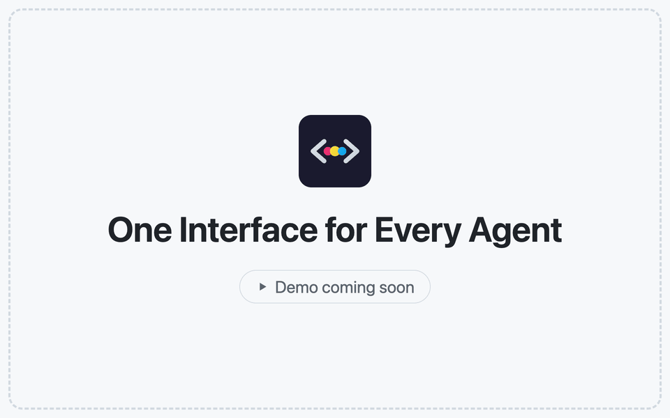
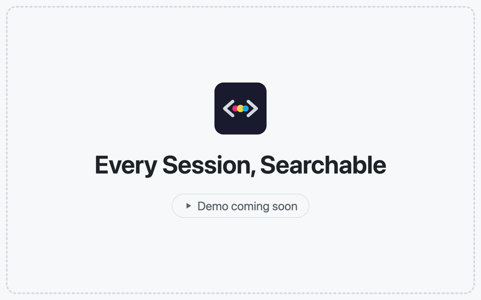
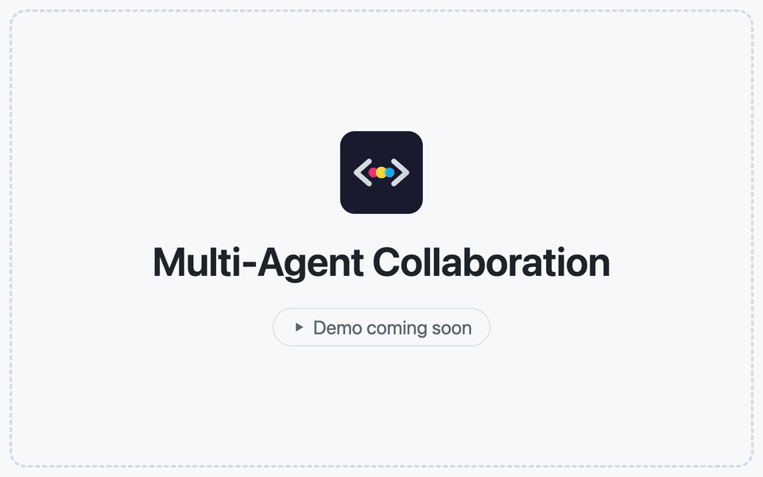
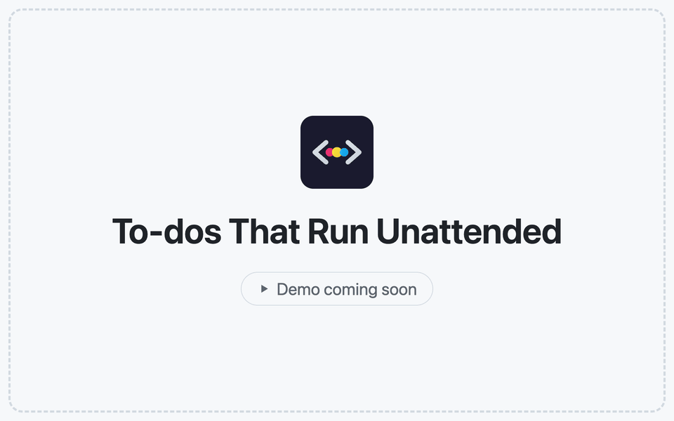
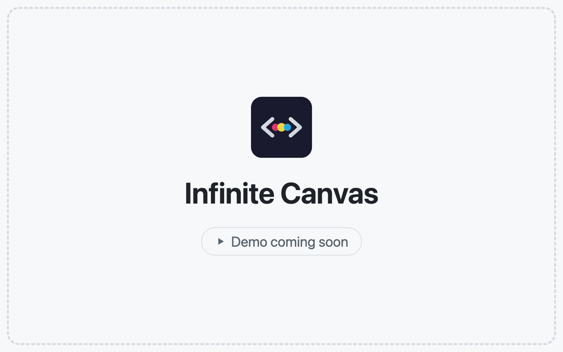
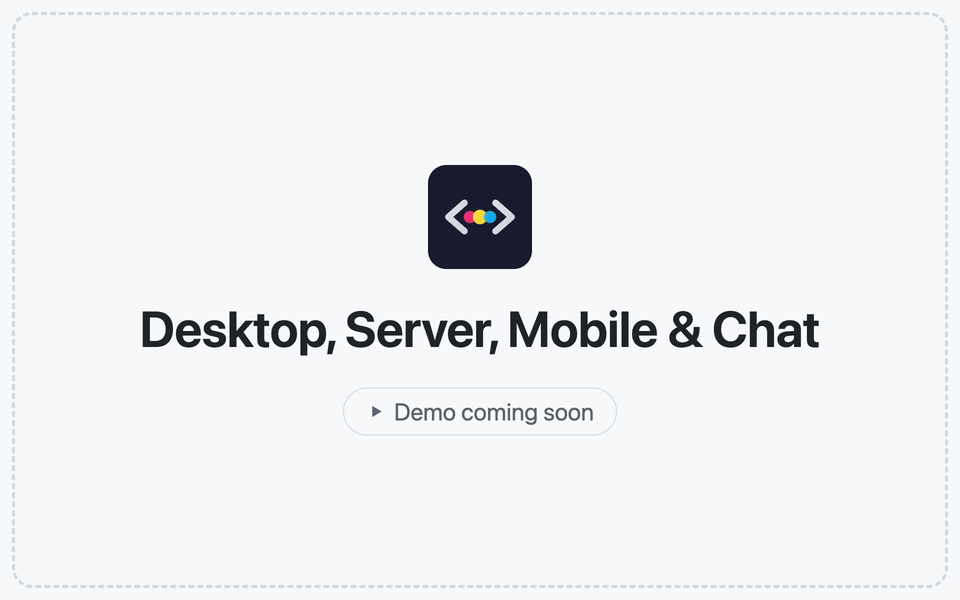
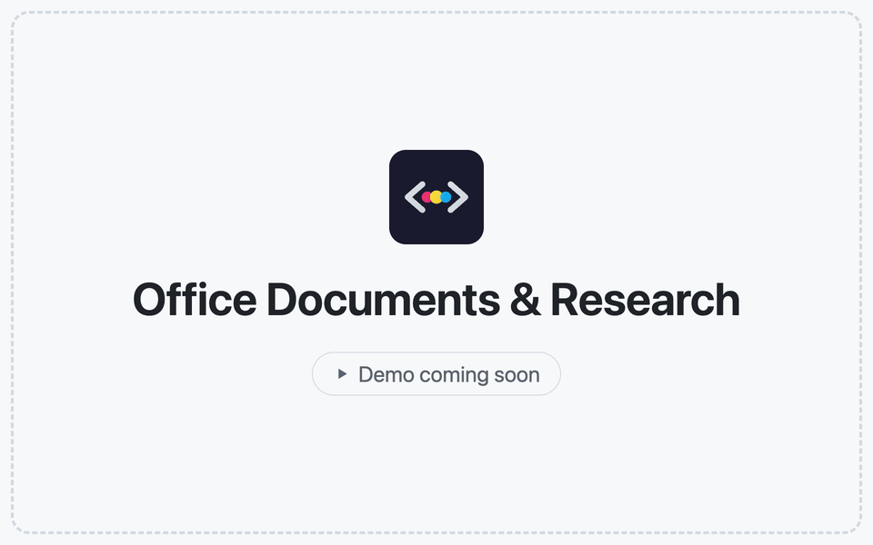
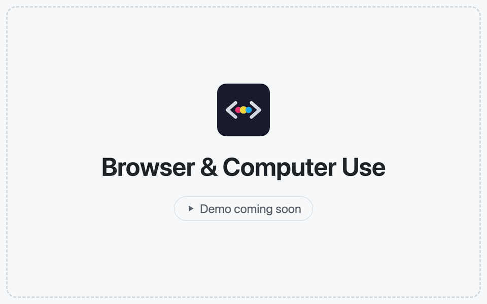

<h1 align="center">
  <a href="https://docs.codeg.app"></a> Codeg
</h1>

<p align="center">
  <a href="https://github.com/spacering-net/codeg"></a>
  <a href="https://github.com/spacering-net/codeg/releases/latest"></a>
  <a href="https://github.com/spacering-net/codeg/releases"></a>
  <a href="../../LICENSE"></a>
  <a href="https://docs.codeg.app"></a>
  <a href="https://docs.codeg.app/getting-started/installation"></a>
</p>

<p align="center">
  <sub><a href="../../README.md">English</a> · <a href="./README.zh-CN.md">简体中文</a> · <a href="./README.zh-TW.md">繁體中文</a> · <strong>日本語</strong> · <a href="./README.ko.md">한국어</a> · <a href="./README.es.md">Español</a> · <a href="./README.de.md">Deutsch</a> · <a href="./README.fr.md">Français</a> · <a href="./README.pt.md">Português</a> · <a href="./README.ar.md">العربية</a></sub>
</p>

<p align="center">
  <strong>マルチエージェント・コーディングワークスペース。</strong><br/>
  あらゆる AI コーディングエージェントをひとつの場所で動かし、そして協働させます。
</p>

<h3 align="center"><a href="https://github.com/spacering-net/codeg/releases/latest"><ins>Codeg をダウンロード</ins></a> · <a href="https://docs.codeg.app"><ins>ドキュメント</ins></a></h3>

<p align="center">
  <picture>
    <source media="(prefers-color-scheme: dark)" srcset="../images/workspace-dark.png" />
    
  </picture>
</p>

<table>
  <tr>
    <td width="50%" valign="top">🧩 <strong>すべてのエージェントを、ひとつのインターフェースで</strong><br/>20 種のエージェントを内蔵し、ACP エージェントならどれでも加えられます — いずれもターミナルではなく、同じ構造化された会話として表示されます。</td>
    <td width="50%" valign="top">🔎 <strong>引き継げるセッション</strong><br/>各エージェントがディスクに残す履歴をインポート・検索・再開でき、さらに別のエージェントへ引き継げます。</td>
  </tr>
  <tr>
    <td width="50%" valign="top">🤝 <strong>協働するエージェント</strong><br/><code>@</code> ひとつでエージェント間の委譲ができ、ToDo タスクをキューに積めば、それぞれ専用のワークツリーで無人のまま進みます。</td>
    <td width="50%" valign="top">🌍 <strong>どこで作業していても</strong><br/>デスクトップアプリ、セルフホストのサーバーまたは Docker、iPhone・iPad・Android — さらに Telegram、Lark、WeChat からも。</td>
  </tr>
</table>

## ✨ 機能

<table>
<tr>
<td width="50%" valign="middle">

### すべてのエージェントを、ひとつのインターフェースで

20 の内蔵エージェントと任意の ACP エージェントに対応。ツールカードや差分、対話型の返答を同じ画面で。

[ドキュメント →](https://docs.codeg.app/guide/supported-agents) · [カスタムエージェント →](https://docs.codeg.app/guide/custom-agents) · [UI レンダリング →](https://docs.codeg.app/guide/skills#cards-tables-and-charts-in-replies)

</td>
<td width="50%">
<picture>
  <source media="(prefers-color-scheme: dark)" srcset="../images/features/agents-dark.gif" />
  
</picture>
</td>
</tr>
<tr>
<td width="50%" valign="middle">

### すべてのセッションを、検索可能に

履歴を取り込み、検索して再開。`@` で別のエージェントにセッションを共有し、タグで整理できます。

[ドキュメント →](https://docs.codeg.app/guide/aggregation) · [タグ →](https://docs.codeg.app/guide/workspace#tag-conversations)

</td>
<td width="50%">
<picture>
  <source media="(prefers-color-scheme: dark)" srcset="../images/features/sessions-dark.gif" />
  
</picture>
</td>
</tr>
<tr>
<td width="50%" valign="middle">

### マルチエージェント協調

`@` でエージェントに依頼。複数のエージェントが並行して働き、進捗が会話に届きます。

[ドキュメント →](https://docs.codeg.app/guide/multi-agent)

</td>
<td width="50%">
<picture>
  <source media="(prefers-color-scheme: dark)" srcset="../images/features/multi-agent-dark.gif" />
  
</picture>
</td>
</tr>
<tr>
<td width="50%" valign="middle">

### 無人で進む ToDo タスク

タスク専用のワークツリーで、今すぐ、または指定時刻に実行。変更はあなたが確認して承認します。

[ドキュメント →](https://docs.codeg.app/guide/tasks) · [自動処理 →](https://docs.codeg.app/guide/repository#let-it-pick-items-up-by-itself)

</td>
<td width="50%">
<picture>
  <source media="(prefers-color-scheme: dark)" srcset="../images/features/todos-dark.gif" />
  
</picture>
</td>
</tr>
<tr>
<td width="50%" valign="middle">

### 無限キャンバス

会話、ファイル、ターミナル、メモを無限のボードに配置。各エージェントの作業をひと目で把握できます。

[ドキュメント →](https://docs.codeg.app/guide/canvas)

</td>
<td width="50%">
<picture>
  <source media="(prefers-color-scheme: dark)" srcset="../images/features/canvas-dark.gif" />
  
</picture>
</td>
</tr>
<tr>
<td width="50%" valign="middle">

### デスクトップ・サーバー・モバイル・チャット

デスクトップ、サーバー、Docker、モバイルに対応。Telegram、Lark、WeChat からもエージェントと会話できます。

[ドキュメント →](https://docs.codeg.app/getting-started/deployment) · [リモートワークスペース →](https://docs.codeg.app/guide/workspace#desktop-and-browser) · [モバイルアプリ →](https://docs.codeg.app/getting-started/installation#mobile-apps) · [チャットチャンネル →](https://docs.codeg.app/guide/chat-channels)

</td>
<td width="50%">
<picture>
  <source media="(prefers-color-scheme: dark)" srcset="../images/features/anywhere-dark.gif" />
  
</picture>
</td>
</tr>
<tr>
<td width="50%" valign="middle">

### Office ドキュメントと科学研究

Office ファイルを作成してライブプレビュー、PDF も閲覧。研究スキルはどのエージェントでも使えます。

[ドキュメント →](https://docs.codeg.app/guide/office) · [科学研究 →](https://docs.codeg.app/guide/research)

</td>
<td width="50%">
<picture>
  <source media="(prefers-color-scheme: dark)" srcset="../images/features/office-dark.gif" />
  
</picture>
</td>
</tr>
<tr>
<td width="50%" valign="middle">

### ブラウザとコンピューター操作

デスクトップの内蔵ブラウザからページやエラーを共有。コンピューター操作（プレビュー）で共有ウィンドウも操作できます。

[ドキュメント →](https://docs.codeg.app/guide/browser) · [コンピューター操作 →](https://docs.codeg.app/guide/computer-use)

</td>
<td width="50%">
<picture>
  <source media="(prefers-color-scheme: dark)" srcset="../images/features/browser-dark.gif" />
  
</picture>
</td>
</tr>
<tr>
<td width="50%" valign="middle">

### コマンドラインと CI

`codeg-cli` でスクリプトや CI から起動中の Codeg に依頼。返答や JSON イベントを出力します。

[ドキュメント →](https://docs.codeg.app/guide/command-line)

</td>
<td width="50%" valign="middle">

```bash
codeg-cli -a codex \
  -p "Review the latest commit"

git diff | codeg-cli -a codex \
  -p "Review this diff"
```

</td>
</tr>
</table>

**このほかにも：**

- **[開発の一連の流れをまるごと](https://docs.codeg.app/guide/workspace)** — コードエディター、ライブ差分、[Git とワークツリー](https://docs.codeg.app/guide/git)、3 ペインのマージエディター、ターミナル、分割表示
- **[リポジトリパネル](https://docs.codeg.app/guide/repository)** — GitHub、GitLab、Gitea、Forgejo のイシュー、プルリクエスト、チェック、マージ。どのイシューや PR も ToDo タスクにできます
- **[オートメーション](https://docs.codeg.app/guide/automations)** — 設定済みの入力欄を保存し、cron スケジュールまたは任意のタイミングでヘッドレス実行
- **[トークン使用量](https://docs.codeg.app/guide/token-usage)** — 推移、キャッシュヒット率、アクティビティのヒートマップ、フォルダー・エージェント・モデル・セッション別の使用量、API の定価で見積もったコスト
- **[分岐とステアリング](https://docs.codeg.app/guide/workspace#follow-along-%E2%80%94-the-conversation)** — 対応しているエージェントでは、完了した返信から会話を分岐させたり、まだ実行中のターンにメッセージを送り込んだりできます
- **[スキル](https://docs.codeg.app/guide/skills) と [MCP](https://docs.codeg.app/guide/mcp)** — エージェントごとのスキルパック、ローカルの MCP スキャン、レジストリの検索とインストール
- **[プロジェクトブート](https://docs.codeg.app/guide/project-boot)** — ライブプレビュー付きで新規プロジェクトを視覚的に構築
- **[通知](https://docs.codeg.app/reference/settings/general#desktop-notifications)** — ターンが終わったときやエージェントに呼ばれたときに、デスクトップ通知と通知音、タスクバーボタンの点滅や Dock アイコンのバウンドで知らせます
- **[自分好みに](https://docs.codeg.app/reference/settings/appearance)** — カラートークン単位で塗り替えられる 12 のテーマ、壁紙、角丸、チャット幅、カスタム CSS、デスクトップペット — インターフェースは 10 言語に対応
- **[バックアップと同期](https://docs.codeg.app/reference/settings/system#backup-restore)** — 暗号化バックアップと、ファイルまたは自分の WebDAV サーバーを介したマシン間の設定同期
- **[URL スキーム](../../docs/url-scheme.md)** — `codeg://session/<id>` で別のアプリから会話を開けます（デスクトップ）
- **まだまだあります** — ほぼすべてのリリースで何かが加わります。全リストは [リリースノート](https://github.com/spacering-net/codeg/releases) で確認できます

## 🤖 対応エージェント

Codeg はすべてのエージェントと [Agent Client Protocol](https://agentclientprotocol.com) で通信するため、どのエージェントにも同じ構造化されたインターフェースが用意されます。20 種を内蔵し、その多くは Codeg がインストール・バージョン固定・更新まで面倒を見ます：

<p>
  <a href="https://www.anthropic.com/claude-code"><kbd> Claude Code</kbd></a> &nbsp;
  <a href="https://github.com/openai/codex"><kbd> Codex</kbd></a> &nbsp;
  <a href="https://github.com/google-gemini/gemini-cli"><kbd> Gemini CLI</kbd></a> &nbsp;
  <a href="https://openclaw.ai"><kbd> OpenClaw</kbd></a> &nbsp;
  <a href="https://opencode.ai"><kbd><picture><source media="(prefers-color-scheme: dark)" srcset="../images/agents/opencode-dark.svg" /></picture> OpenCode</kbd></a> &nbsp;
  <a href="https://cline.bot"><kbd><picture><source media="(prefers-color-scheme: dark)" srcset="../images/agents/cline-dark.svg" /></picture> Cline</kbd></a> &nbsp;
  <a href="https://hermes-agent.nousresearch.com"><kbd><picture><source media="(prefers-color-scheme: dark)" srcset="../images/agents/hermes-agent-dark.svg" /></picture> Hermes Agent</kbd></a> &nbsp;
  <a href="https://www.codebuddy.ai"><kbd><picture><source media="(prefers-color-scheme: dark)" srcset="../images/agents/codebuddy-dark.svg" /></picture> CodeBuddy</kbd></a> &nbsp;
  <a href="https://www.kimi.com/code"><kbd> Kimi Code</kbd></a> &nbsp;
  <a href="../agents/minimax-code.md"><kbd> MiniMax Code</kbd></a> &nbsp;
  <a href="https://pi.dev"><kbd> Pi</kbd></a> &nbsp;
  <a href="https://x.ai/cli"><kbd><picture><source media="(prefers-color-scheme: dark)" srcset="../images/agents/grok-dark.svg" /></picture> Grok</kbd></a> &nbsp;
  <a href="https://cursor.com/cli"><kbd><picture><source media="(prefers-color-scheme: dark)" srcset="../images/agents/cursor-dark.svg" /></picture> Cursor</kbd></a> &nbsp;
  <a href="https://deepseek-harness.github.io/deepseek-harness/"><kbd> DeepSeek Harness</kbd></a> &nbsp;
  <a href="https://qoder.com"><kbd><picture><source media="(prefers-color-scheme: dark)" srcset="../images/agents/qoder-dark.svg" /></picture> Qoder</kbd></a> &nbsp;
  <a href="https://antigravity.google"><kbd><picture><source media="(prefers-color-scheme: dark)" srcset="../images/agents/google-antigravity-dark.svg" /></picture> Google Antigravity</kbd></a> &nbsp;
  <a href="https://kiro.dev/cli/"><kbd> Kiro CLI</kbd></a> &nbsp;
  <a href="../agents/zcode.md"><kbd> ZCode</kbd></a> &nbsp;
  <a href="https://docs.trae.cn/cli_about-trae-code-cli-2"><kbd> TRAE CLI</kbd></a> &nbsp;
  <a href="https://commandcode.ai"><kbd> Command Code</kbd></a> &nbsp;
  <a href="https://docs.codeg.app/guide/custom-agents"><kbd>+ 任意の ACP エージェント</kbd></a>
</p>

リストにない？公開されている ACP レジストリから好きなエージェントを選ぶか、その distribution JSON を貼り付ければ、Codeg がインストールし、起動できるかを確かめ、内蔵エージェントと同じように扱います。各エージェントの実行環境要件とセッションの保存場所は [対応エージェント](https://docs.codeg.app/guide/supported-agents) を参照してください。

## 📦 インストール

**デスクトップ** — macOS・Windows・Linux 向けインストーラーは [Releases](https://github.com/spacering-net/codeg/releases/latest) にあります。セットアップ手順は [インストール](https://docs.codeg.app/getting-started/installation) を参照してください。

**サーバー** — Codeg をヘッドレスで動かし、任意のブラウザから利用します。Linux / macOS の場合：

```bash
curl -fsSL https://raw.githubusercontent.com/spacering-net/codeg/main/install.sh | bash
CODEG_STATIC_DIR=/usr/local/share/codeg/web codeg-server
```

Windows（PowerShell）の場合：

```powershell
irm https://raw.githubusercontent.com/spacering-net/codeg/main/install.ps1 | iex
$env:CODEG_STATIC_DIR="$env:LOCALAPPDATA\codeg-server\web"; codeg-server
```

**Docker** — 同じサーバーを、ひとつのコンテナで：

```bash
docker run -d -p 3080:3080 -v codeg-data:/data ghcr.io/spacering-net/codeg:latest
```

どちらの場合も、ブラウザで `http://<host>:3080` を開き、サーバーが起動時に出力するアクセストークンを入力します（コンテナでは `docker logs` で確認できます）。`CODEG_TOKEN` で自分で決めることもできます。

**モバイル** — [iOS アプリ](https://apps.apple.com/app/codeg-client/id6785199071) または [Android APK](https://github.com/xintaofei/codeg-android/releases/latest) をインストールし、デスクトップアプリの **Webサービス**か自分の `codeg-server` を指定するだけ：アドレスとトークンを入れれば完了です。接続手順は [モバイルアプリ](https://docs.codeg.app/getting-started/installation#mobile-apps)。

Compose、ビルド済みバイナリ、ソースからのビルド、その場での更新は [デプロイ](https://docs.codeg.app/getting-started/deployment) に、環境変数は [設定](https://docs.codeg.app/getting-started/configuration) にあります。

## 👥 コミュニティとサポート

- **WeChat** — QRコードをスキャンして、ディスカッション、フィードバック、アップデートのためのグループに参加してください：

  <picture>
    <source media="(prefers-color-scheme: dark)" srcset="../images/weixin-dark.jpg" />
    
  </picture>

- **イシュー** — バグを見つけた？欲しい機能がない？[イシューを作成してください](https://github.com/spacering-net/codeg/issues)。
- **プライバシー** — ローカル優先：解析・保存・プロジェクト操作はあなたのマシン上にとどまり、Web モードとサーバーモードはトークン認証で保護されます。詳細は [プライバシーとセキュリティ](https://docs.codeg.app/reference/privacy) を参照してください。
- **LinuxDO** — [LinuxDO](https://linux.do) コミュニティのサポートに感謝します。
- **応援する** — [リポジトリにスターを付けて](https://github.com/spacering-net/codeg)、今後の進展をフォローしてください。

## 🤝 コントリビューション

イシューもプルリクエストも歓迎します。Codeg を自分でビルドするなら、まず [開発](https://docs.codeg.app/reference/development) と [アーキテクチャ](https://docs.codeg.app/reference/architecture) から読んでください。

<a href="https://github.com/spacering-net/codeg/graphs/contributors">
  
</a>

## ⭐ スター履歴

<a href="https://www.star-history.com/?repos=spacering-net%2Fcodeg&type=date&releases=&legend=bottom-right">
 <picture>
   <source media="(prefers-color-scheme: dark)" srcset="https://api.star-history.com/chart?repos=spacering-net/codeg&type=date&theme=dark&legend=bottom-right" />
   <source media="(prefers-color-scheme: light)" srcset="https://api.star-history.com/chart?repos=spacering-net/codeg&type=date&legend=bottom-right" />
   
 </picture>
</a>

## 🙏 謝辞

- [Agent Client Protocol](https://agentclientprotocol.com) — Codeg が対応するすべてのエージェントへ接続できる土台
- [Superpowers](https://github.com/obra/superpowers) — Codeg のエキスパートスキルモジュールを支えるプロジェクト
- [OfficeCLI](https://github.com/iOfficeAI/OfficeCLI) — Codeg の Office ドキュメントワークフローを支えるプロジェクト
- [scientific-agent-skills](https://github.com/K-Dense-AI/scientific-agent-skills) — Codeg の科学研究スキルを支えるプロジェクト（MIT ライセンスのサブセット）
- [json-render](https://github.com/vercel-labs/json-render) — Codeg の UI レンダリング（カード・表・グラフ）を支えるプロジェクト
- [cua-driver](https://github.com/trycua/cua) — Codeg のコンピューター操作を支えるプロジェクト

## 📜 ライセンス

Apache-2.0。[LICENSE](../../LICENSE) を参照してください。
