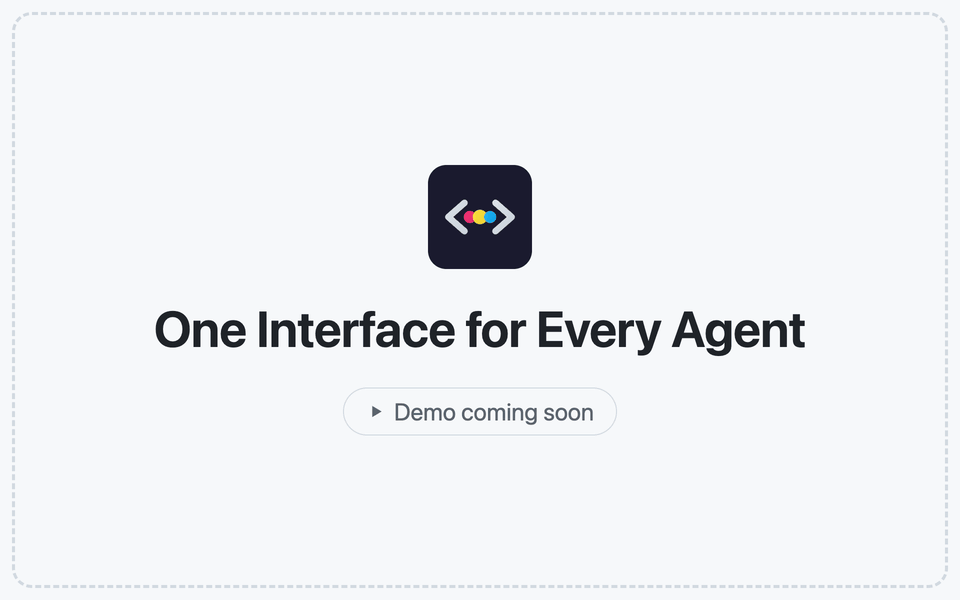
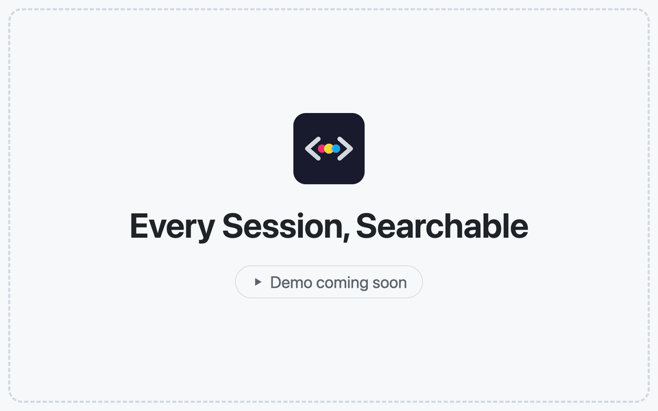
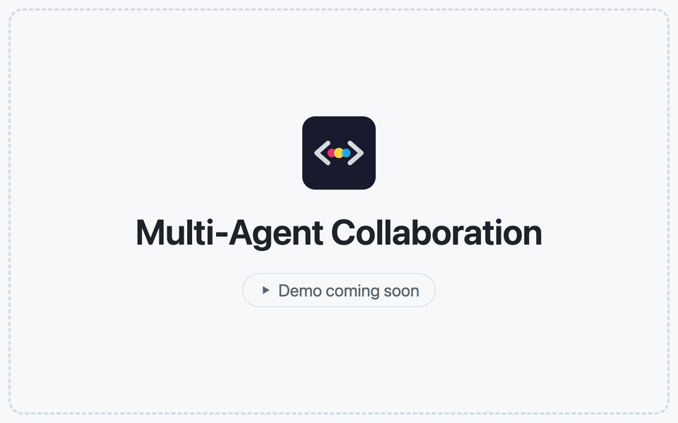
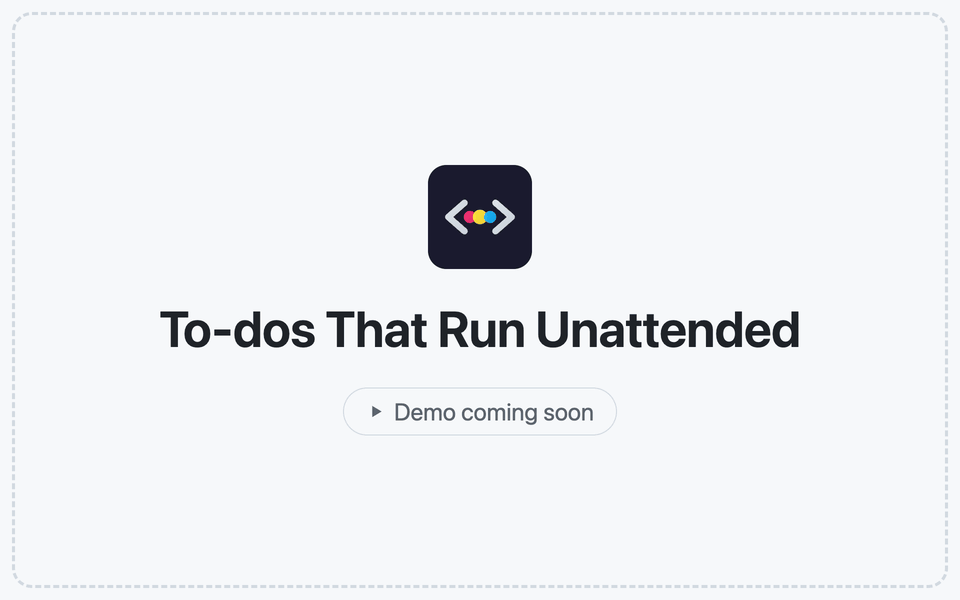
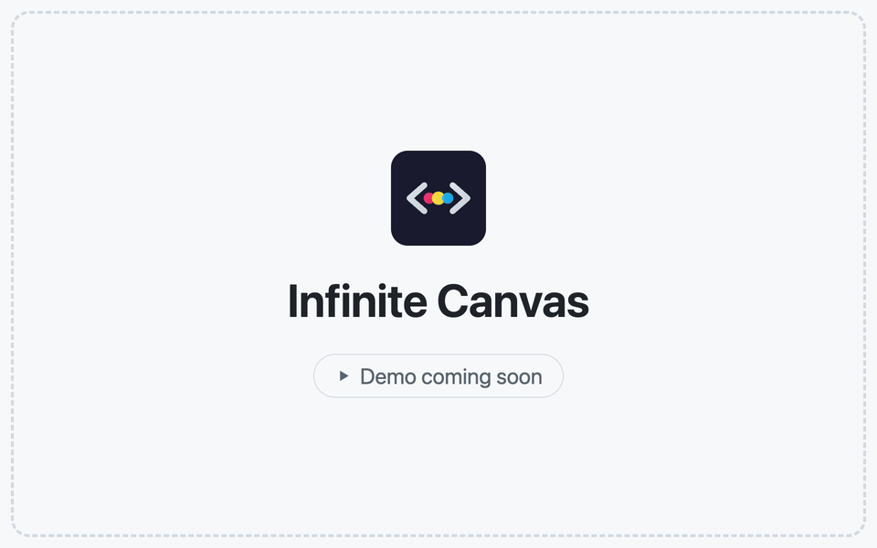
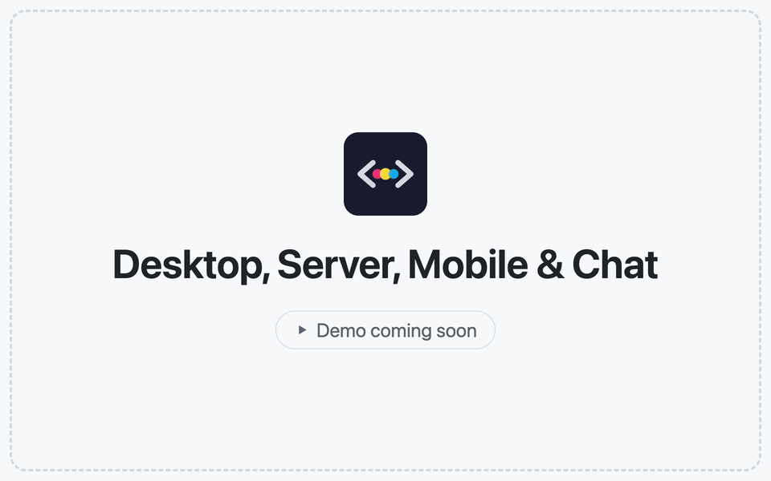
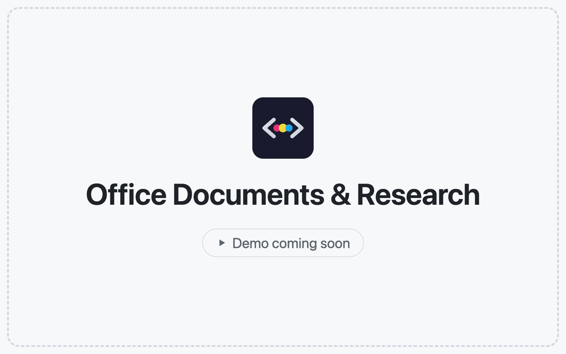
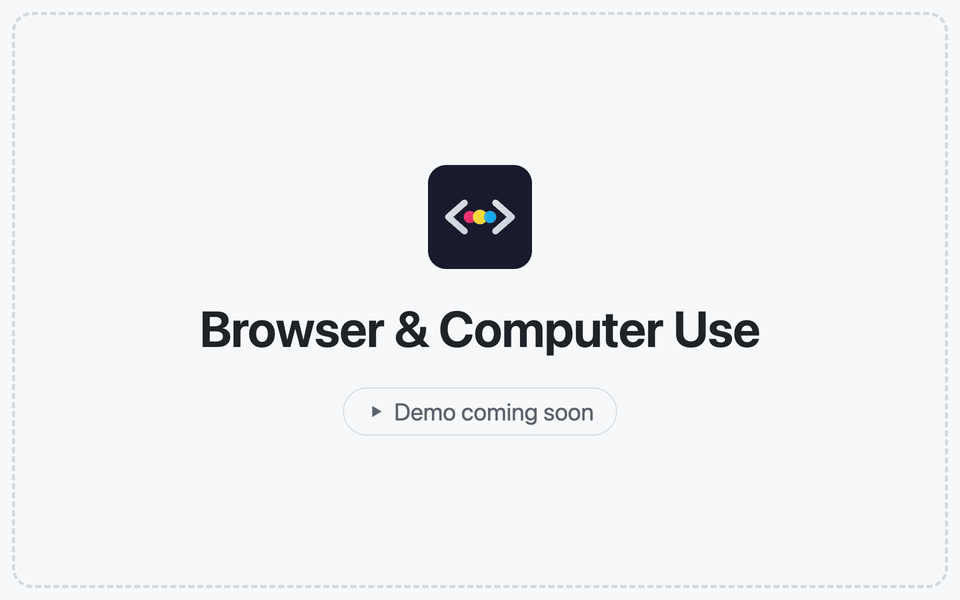

<h1 align="center">
  <a href="https://docs.codeg.app"></a> Codeg
</h1>

<p align="center">
  <a href="https://github.com/spacering-net/codeg"></a>
  <a href="https://github.com/spacering-net/codeg/releases/latest"></a>
  <a href="https://github.com/spacering-net/codeg/releases"></a>
  <a href="../../LICENSE"></a>
  <a href="https://docs.codeg.app"></a>
  <a href="https://docs.codeg.app/zh/getting-started/installation"></a>
</p>

<p align="center">
  <sub><a href="../../README.md">English</a> · <a href="./README.zh-CN.md">简体中文</a> · <strong>繁體中文</strong> · <a href="./README.ja.md">日本語</a> · <a href="./README.ko.md">한국어</a> · <a href="./README.es.md">Español</a> · <a href="./README.de.md">Deutsch</a> · <a href="./README.fr.md">Français</a> · <a href="./README.pt.md">Português</a> · <a href="./README.ar.md">العربية</a></sub>
</p>

<p align="center">
  <strong>多智慧體編碼工作台。</strong><br/>
  把所有 AI 編碼智慧體收進同一個地方——並讓它們協同工作。
</p>

<h3 align="center"><a href="https://github.com/spacering-net/codeg/releases/latest"><ins>下載 Codeg</ins></a> · <a href="https://docs.codeg.app/zh"><ins>說明文件</ins></a></h3>

<p align="center">
  <picture>
    <source media="(prefers-color-scheme: dark)" srcset="../images/workspace-dark.png" />
    
  </picture>
</p>

<table>
  <tr>
    <td width="50%" valign="top">🧩 <strong>一個介面，容納所有智慧體</strong><br/>內建二十個智慧體，任何相容 ACP 的智慧體也都能加入——全部呈現為同一套結構化對話，而不是一個終端機。</td>
    <td width="50%" valign="top">🔎 <strong>工作階段自由流轉</strong><br/>匯入、搜尋、接續每個智慧體留在磁碟上的歷史，還能把它交給另一個智慧體接手。</td>
  </tr>
  <tr>
    <td width="50%" valign="top">🤝 <strong>智慧體協同工作</strong><br/>一個 <code>@</code> 就能跨智慧體委派，也可以把待辦任務排進佇列，在各自的工作樹裡無人看管地執行。</td>
    <td width="50%" valign="top">🌍 <strong>無論你在哪裡工作</strong><br/>桌面應用、自架伺服器或 Docker，iPhone、iPad 與 Android——還有 Telegram、飛書或微信。</td>
  </tr>
</table>

## ✨ 功能特色

<table>
<tr>
<td width="50%" valign="middle">

### 一個介面，容納所有智慧體

二十個內建智慧體，相容任意 ACP 智慧體。工具卡片、即時 diff 與互動式回覆，盡在同一介面。

[文件 →](https://docs.codeg.app/zh/guide/supported-agents) · [自訂智慧體 →](https://docs.codeg.app/zh/guide/custom-agents) · [介面渲染 →](https://docs.codeg.app/zh/guide/skills#cards-tables-and-charts-in-replies)

</td>
<td width="50%">
<picture>
  <source media="(prefers-color-scheme: dark)" srcset="../images/features/agents-dark.gif" />
  
</picture>
</td>
</tr>
<tr>
<td width="50%" valign="middle">

### 每個工作階段，都搜得到

一鍵匯入、搜尋並繼續歷史對話。用 `@` 跨智慧體分享工作階段，用標籤整理對話。

[文件 →](https://docs.codeg.app/zh/guide/aggregation) · [標籤 →](https://docs.codeg.app/zh/guide/workspace#tag-conversations)

</td>
<td width="50%">
<picture>
  <source media="(prefers-color-scheme: dark)" srcset="../images/features/sessions-dark.gif" />
  
</picture>
</td>
</tr>
<tr>
<td width="50%" valign="middle">

### 多智慧體協作

用 `@` 委派任務，讓多個智慧體平行協作，進度即時匯入目前的對話。

[文件 →](https://docs.codeg.app/zh/guide/multi-agent)

</td>
<td width="50%">
<picture>
  <source media="(prefers-color-scheme: dark)" srcset="../images/features/multi-agent-dark.gif" />
  
</picture>
</td>
</tr>
<tr>
<td width="50%" valign="middle">

### 無人看管也能跑的待辦任務

任務擁有獨立工作樹，可立即執行或排程啟動。智慧體完成工作，由你驗收變更。

[文件 →](https://docs.codeg.app/zh/guide/tasks) · [自動處理 →](https://docs.codeg.app/zh/guide/repository#let-it-pick-items-up-by-itself)

</td>
<td width="50%">
<picture>
  <source media="(prefers-color-scheme: dark)" srcset="../images/features/todos-dark.gif" />
  
</picture>
</td>
</tr>
<tr>
<td width="50%" valign="middle">

### 無限畫布

在無限畫布上擺放對話、檔案、終端機與便箋，讓多個智慧體的工作一目了然。

[文件 →](https://docs.codeg.app/zh/guide/canvas)

</td>
<td width="50%">
<picture>
  <source media="(prefers-color-scheme: dark)" srcset="../images/features/canvas-dark.gif" />
  
</picture>
</td>
</tr>
<tr>
<td width="50%" valign="middle">

### 桌面、伺服器、行動裝置與聊天軟體

支援桌面、伺服器、Docker 與行動裝置，也能透過 Telegram、飛書和微信與智慧體對話。

[文件 →](https://docs.codeg.app/zh/getting-started/deployment) · [遠端工作區 →](https://docs.codeg.app/zh/guide/workspace#desktop-and-browser) · [行動應用 →](https://docs.codeg.app/zh/getting-started/installation#mobile-apps) · [訊息頻道 →](https://docs.codeg.app/zh/guide/chat-channels)

</td>
<td width="50%">
<picture>
  <source media="(prefers-color-scheme: dark)" srcset="../images/features/anywhere-dark.gif" />
  
</picture>
</td>
</tr>
<tr>
<td width="50%" valign="middle">

### Office 文件與科學研究

產生 Office 文件並即時預覽，直接檢視 PDF。內建科研技能，任意智慧體都能使用。

[文件 →](https://docs.codeg.app/zh/guide/office) · [科學研究 →](https://docs.codeg.app/zh/guide/research)

</td>
<td width="50%">
<picture>
  <source media="(prefers-color-scheme: dark)" srcset="../images/features/office-dark.gif" />
  
</picture>
</td>
</tr>
<tr>
<td width="50%" valign="middle">

### 瀏覽器與電腦操作

從桌面內建瀏覽器分享頁面與錯誤，用電腦操作（預覽版）讓智慧體操作共享視窗。

[文件 →](https://docs.codeg.app/zh/guide/browser) · [電腦操作 →](https://docs.codeg.app/zh/guide/computer-use)

</td>
<td width="50%">
<picture>
  <source media="(prefers-color-scheme: dark)" srcset="../images/features/browser-dark.gif" />
  
</picture>
</td>
</tr>
<tr>
<td width="50%" valign="middle">

### 命令列與 CI

`codeg-cli` 將腳本與 CI 接入執行中的 Codeg，輸出智慧體回覆或 JSON 事件。

[文件 →](https://docs.codeg.app/zh/guide/command-line)

</td>
<td width="50%" valign="middle">

```bash
codeg-cli -a codex \
  -p "Review the latest commit"

git diff | codeg-cli -a codex \
  -p "Review this diff"
```

</td>
</tr>
</table>

**還有這些：**

- **[完整的工程閉環](https://docs.codeg.app/zh/guide/workspace)** — 程式碼編輯器、即時 diff、[Git 與工作樹](https://docs.codeg.app/zh/guide/git)、三欄合併編輯器、終端機與分割檢視
- **[儲存庫面板](https://docs.codeg.app/zh/guide/repository)** — GitHub、GitLab、Gitea 與 Forgejo 的議題、拉取請求、檢查項與合併；任何議題或 PR 都能轉成待辦任務
- **[自動化](https://docs.codeg.app/zh/guide/automations)** — 把設定好的輸入框存下來，依 cron 排程或手動觸發，以無介面方式執行
- **[Token 用量](https://docs.codeg.app/zh/guide/token-usage)** — 趨勢、快取命中率、活躍熱力圖、依資料夾、智慧體、模型與工作階段劃分的用量，以及按 API 標價估算的費用
- **[分叉與插話](https://docs.codeg.app/zh/guide/workspace#follow-along-%E2%80%94-the-conversation)** — 在支援的智慧體上，從已完成的回覆分叉對話，或把訊息插入仍在進行中的回合
- **[技能](https://docs.codeg.app/zh/guide/skills) 與 [MCP](https://docs.codeg.app/zh/guide/mcp)** — 依智慧體分別啟用的技能包、本機 MCP 掃描，以及註冊表搜尋與安裝
- **[專案啟動器](https://docs.codeg.app/zh/guide/project-boot)** — 視覺化建立新專案，並即時預覽
- **[通知與提醒](https://docs.codeg.app/zh/reference/settings/general#desktop-notifications)** — 回合結束或智慧體需要你時，發出桌面通知與提示音，並讓工作列按鈕閃爍、Dock 圖示跳動
- **[外觀自訂](https://docs.codeg.app/zh/reference/settings/appearance)** — 十二套主題都能逐個色彩 token 重新調色，還有桌布、圓角、聊天區域寬度、自訂 CSS 與桌面寵物——介面支援十種語言
- **[備份與同步](https://docs.codeg.app/zh/reference/settings/system#backup-restore)** — 加密備份，以及透過檔案或你自己的 WebDAV 伺服器在多台機器之間同步設定
- **[URL Scheme](../../docs/url-scheme.md)** — 用 `codeg://session/<id>` 從其他應用程式開啟對話（桌面端）
- **還有更多** — 幾乎每個版本都會加入新東西；完整清單見 [發行說明](https://github.com/spacering-net/codeg/releases)

## 🤖 支援的智慧體

Codeg 透過 [Agent Client Protocol](https://agentclientprotocol.com) 與每個智慧體溝通，所以每一個都能用上同一套結構化介面。內建二十個，其中大部分 Codeg 都能替你安裝、鎖定版本並更新：

<p>
  <a href="https://www.anthropic.com/claude-code"><kbd> Claude Code</kbd></a> &nbsp;
  <a href="https://github.com/openai/codex"><kbd> Codex</kbd></a> &nbsp;
  <a href="https://github.com/google-gemini/gemini-cli"><kbd> Gemini CLI</kbd></a> &nbsp;
  <a href="https://openclaw.ai"><kbd> OpenClaw</kbd></a> &nbsp;
  <a href="https://opencode.ai"><kbd><picture><source media="(prefers-color-scheme: dark)" srcset="../images/agents/opencode-dark.svg" /></picture> OpenCode</kbd></a> &nbsp;
  <a href="https://cline.bot"><kbd><picture><source media="(prefers-color-scheme: dark)" srcset="../images/agents/cline-dark.svg" /></picture> Cline</kbd></a> &nbsp;
  <a href="https://hermes-agent.nousresearch.com"><kbd><picture><source media="(prefers-color-scheme: dark)" srcset="../images/agents/hermes-agent-dark.svg" /></picture> Hermes Agent</kbd></a> &nbsp;
  <a href="https://www.codebuddy.ai"><kbd><picture><source media="(prefers-color-scheme: dark)" srcset="../images/agents/codebuddy-dark.svg" /></picture> CodeBuddy</kbd></a> &nbsp;
  <a href="https://www.kimi.com/code"><kbd> Kimi Code</kbd></a> &nbsp;
  <a href="../agents/minimax-code.md"><kbd> MiniMax Code</kbd></a> &nbsp;
  <a href="https://pi.dev"><kbd> Pi</kbd></a> &nbsp;
  <a href="https://x.ai/cli"><kbd><picture><source media="(prefers-color-scheme: dark)" srcset="../images/agents/grok-dark.svg" /></picture> Grok</kbd></a> &nbsp;
  <a href="https://cursor.com/cli"><kbd><picture><source media="(prefers-color-scheme: dark)" srcset="../images/agents/cursor-dark.svg" /></picture> Cursor</kbd></a> &nbsp;
  <a href="https://deepseek-harness.github.io/deepseek-harness/"><kbd> DeepSeek Harness</kbd></a> &nbsp;
  <a href="https://qoder.com"><kbd><picture><source media="(prefers-color-scheme: dark)" srcset="../images/agents/qoder-dark.svg" /></picture> Qoder</kbd></a> &nbsp;
  <a href="https://antigravity.google"><kbd><picture><source media="(prefers-color-scheme: dark)" srcset="../images/agents/google-antigravity-dark.svg" /></picture> Google Antigravity</kbd></a> &nbsp;
  <a href="https://kiro.dev/cli/"><kbd> Kiro CLI</kbd></a> &nbsp;
  <a href="../agents/zcode.md"><kbd> ZCode</kbd></a> &nbsp;
  <a href="https://docs.trae.cn/cli_about-trae-code-cli-2"><kbd> TRAE CLI</kbd></a> &nbsp;
  <a href="https://commandcode.ai"><kbd> Command Code</kbd></a> &nbsp;
  <a href="https://docs.codeg.app/zh/guide/custom-agents"><kbd>+ 任何 ACP 智慧體</kbd></a>
</p>

名單之外的呢？從公開的 ACP 註冊表裡挑一個，或貼上它的 distribution JSON——Codeg 會安裝它、預檢它能否啟動，然後像對待內建智慧體一樣對待它。各智慧體的執行環境需求以及工作階段的存放位置，見 [支援的智慧體](https://docs.codeg.app/zh/guide/supported-agents)。

## 📦 安裝

**桌面端** — 從 [Releases](https://github.com/spacering-net/codeg/releases/latest) 下載 macOS、Windows 或 Linux 的安裝檔，再依 [安裝](https://docs.codeg.app/zh/getting-started/installation) 操作。

**伺服器** — 無介面執行 Codeg，用任意瀏覽器存取。Linux 或 macOS：

```bash
curl -fsSL https://raw.githubusercontent.com/spacering-net/codeg/main/install.sh | bash
CODEG_STATIC_DIR=/usr/local/share/codeg/web codeg-server
```

Windows（PowerShell）：

```powershell
irm https://raw.githubusercontent.com/spacering-net/codeg/main/install.ps1 | iex
$env:CODEG_STATIC_DIR="$env:LOCALAPPDATA\codeg-server\web"; codeg-server
```

**Docker** — 同一個伺服器，裝進一個容器：

```bash
docker run -d -p 3080:3080 -v codeg-data:/data ghcr.io/spacering-net/codeg:latest
```

無論哪種方式，都在瀏覽器中開啟 `http://<host>:3080`，輸入伺服器啟動時印出的存取權杖（容器可用 `docker logs` 查看）；也可以用 `CODEG_TOKEN` 自行指定。

**行動裝置** — 安裝 [iOS 應用](https://apps.apple.com/app/codeg-client/id6785199071) 或 [Android APK](https://github.com/xintaofei/codeg-android/releases/latest)，再把它指向桌面應用的 **Web 服務**或你自己的 `codeg-server`：填位址、填權杖，完成。配對步驟見 [行動應用](https://docs.codeg.app/zh/getting-started/installation#mobile-apps)。

Compose、預編譯二進位檔、原始碼建置與就地升級見 [部署](https://docs.codeg.app/zh/getting-started/deployment)；環境變數見 [設定](https://docs.codeg.app/zh/getting-started/configuration)。

## 👥 社群與支援

- **微信** — 掃描下方 QR Code 加入我們的微信群，參與討論、回饋與更新：

  <picture>
    <source media="(prefers-color-scheme: dark)" srcset="../images/weixin-dark.jpg" />
    
  </picture>

- **問題回報** — 發現 bug，或是缺了什麼功能？[開一個 issue](https://github.com/spacering-net/codeg/issues)。
- **隱私** — 本機優先：解析、儲存與專案操作都留在你的機器上，Web 模式與伺服器模式皆以權杖驗證把關。詳見 [隱私與安全](https://docs.codeg.app/zh/reference/privacy)。
- **LinuxDO** — 感謝 [LinuxDO](https://linux.do) 社群的支持。
- **支持我們** — [幫儲存庫點個 Star](https://github.com/spacering-net/codeg)，追蹤後續進展。

## 🤝 參與貢獻

歡迎提交 issue 與 pull request。想自己建置 Codeg，可以從 [開發](https://docs.codeg.app/zh/reference/development) 與 [架構](https://docs.codeg.app/zh/reference/architecture) 開始。

<a href="https://github.com/spacering-net/codeg/graphs/contributors">
  
</a>

## ⭐ Star 歷史

<a href="https://www.star-history.com/?repos=spacering-net%2Fcodeg&type=date&releases=&legend=bottom-right">
 <picture>
   <source media="(prefers-color-scheme: dark)" srcset="https://api.star-history.com/chart?repos=spacering-net/codeg&type=date&theme=dark&legend=bottom-right" />
   <source media="(prefers-color-scheme: light)" srcset="https://api.star-history.com/chart?repos=spacering-net/codeg&type=date&legend=bottom-right" />
   
 </picture>
</a>

## 🙏 致謝

- [Agent Client Protocol](https://agentclientprotocol.com)：Codeg 得以連接所有支援的智慧體的基礎
- [Superpowers](https://github.com/obra/superpowers)：為 Codeg 的專家技能模組提供支援
- [OfficeCLI](https://github.com/iOfficeAI/OfficeCLI)：為 Codeg 的 Office 文件工作流程提供支援
- [scientific-agent-skills](https://github.com/K-Dense-AI/scientific-agent-skills)：為 Codeg 的科學研究技能提供支援（MIT 授權子集）
- [json-render](https://github.com/vercel-labs/json-render)：為 Codeg 的介面渲染（卡片、表格與圖表）提供支援
- [cua-driver](https://github.com/trycua/cua)：為 Codeg 的電腦操作提供支援

## 📜 授權

Apache-2.0，詳見 [LICENSE](../../LICENSE)。
